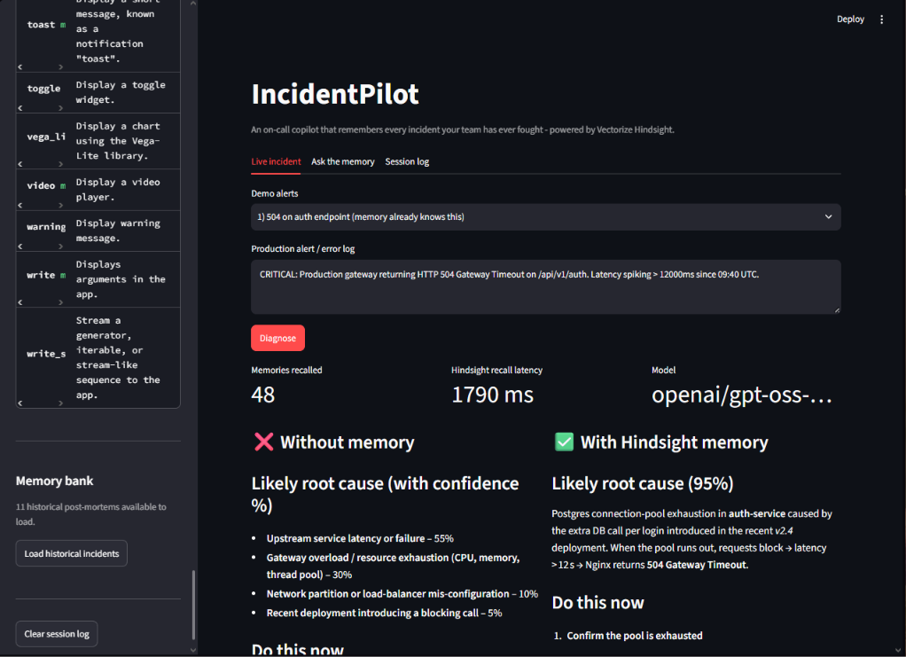
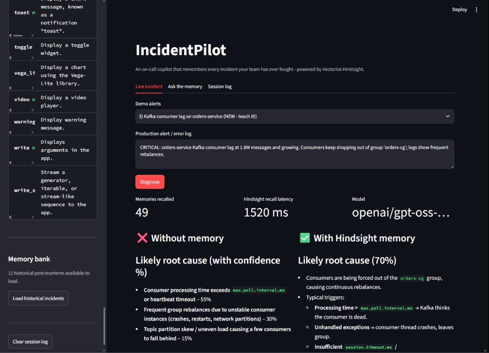
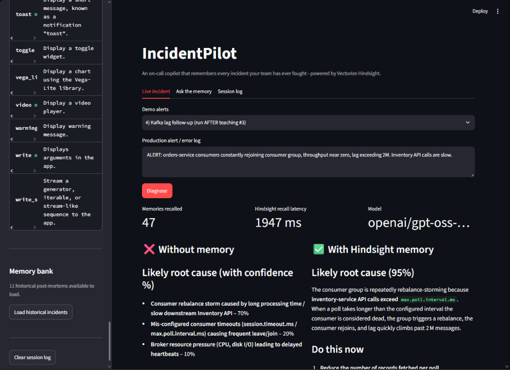
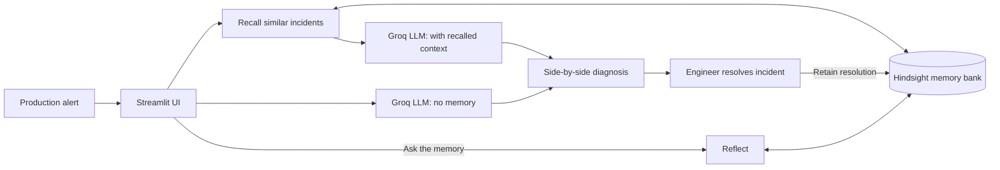

# IncidentPilot

**An on-call copilot that remembers every incident your team has ever fought.**
Built on [Vectorize Hindsight](https://github.com/vectorize-io/hindsight) agent memory, with Groq for fast LLM inference.

At 3 AM, the fix is usually already in someone's post-mortem. IncidentPilot makes sure the agent has read it.

## The problem

Stateless AI assistants give generic advice during outages: check the logs, restart the service, look at CPU. They don't know that your team hit this exact 504 last month, or that the "obvious" fix (raising an nginx timeout) was tried and **didn't work**. Every incident starts from zero, and the same mistakes get repeated.

## What IncidentPilot does

Paste a production alert and IncidentPilot runs two diagnoses side by side, in parallel:

| Without memory | With Hindsight memory |
|---|---|
| Generic checklist from the LLM alone | Recalls similar past incidents first, then diagnoses |
| "None - no team history available." | Cites the matching incident and the fix that worked |
| Can suggest fixes your team already tried and abandoned | Warns you off fixes that previously **failed** |

When you resolve an incident, you teach it back through a form. That resolution is retained in Hindsight and used on the very next similar alert. This is the learning loop.

## Before / after (real output from the app)

**1. Memory-backed diagnosis of a known issue** (`504 on /api/v1/auth`)
The memory side reaches 90% confidence, matches the symptoms to INC-8821 (Postgres pool exhaustion), and explicitly warns not to repeat the nginx timeout increase from INC-8815, which failed.



**2. Before: an unknown issue** (Kafka consumer lag on `orders-service`)
Memory has no Kafka incident. The agent says so plainly and falls back to general best practice instead of inventing history.



**3. After: one incident taught, next alert improves**
After the resolution is retained in Hindsight, a follow-up alert is diagnosed at 95% confidence, cites the taught incident, and reproduces the team's exact fix (lower `max.poll.records`, raise `max.poll.interval.ms`, `CooperativeStickyAssignor`, 2 s timeout on the inventory call). The no-memory column stays generic.



## How Hindsight is used

Memory is the core of the product, not a bolt-on. All memory access goes through the official [`hindsight-client`](https://hindsight.vectorize.io/) SDK, wrapped in `memory.py`.

| Hindsight operation | Where it's used |
|---|---|
| **Retain** | Seeding historical post-mortems (`retain_batch`) and the "Teach IncidentPilot" form (`retain_incident`). Each incident stores service, root cause, fix, and outcome (`resolved` or `fix_failed`), so failed fixes are remembered too. |
| **Recall** | On every alert, similar incidents are recalled and injected into the prompt before the model answers. The UI shows the memory count and recall latency. |
| **Reflect** | The **Ask the memory** tab lets you ask questions like "What usually fixes database connection pool exhaustion?" and get a synthesized answer over the whole incident history. |

There is no mock or fallback memory. If Hindsight is unreachable, the app raises `MemoryUnavailable` and says so, rather than faking a result.

## Architecture



## Features

- Side-by-side "without memory vs with Hindsight memory" diagnosis, run in parallel
- Recalled memories shown in an expander, so you can see exactly what the agent used
- Learning loop: retain a new resolution and see the next answer improve
- Failed fixes are stored and surfaced as "Do NOT do" warnings
- **Ask the memory** tab powered by Hindsight `reflect`
- Session log tab tracking diagnoses, memory counts and latency
- Model fallback chain on Groq: `openai/gpt-oss-120b` → `qwen/qwen3-32b` → `llama-3.3-70b-versatile`
- 11 realistic seed incidents (including 2 where the first fix failed)

## Setup

**Prerequisites:** Python 3.10+, a [Groq API key](https://console.groq.com/), and a [Hindsight Cloud](https://ui.hindsight.vectorize.io) API key (or a self-hosted Hindsight instance).

```bash
git clone https://github.com/YOUR_USERNAME/incident-pilot.git
cd incident-pilot

python -m venv venv
# Windows:  venv\Scripts\activate
# macOS/Linux:  source venv/bin/activate

pip install -r requirements.txt
```

Create your environment file:

```bash
# Windows:  copy .env.example .env
# macOS/Linux:  cp .env.example .env
```

Then edit `.env`:

```
GROQ_API_KEY=your_groq_key_here
HINDSIGHT_API_KEY=your_hindsight_key_here
HINDSIGHT_BASE_URL=https://api.hindsight.vectorize.io
HINDSIGHT_BANK_ID=incident-pilot-prod
```

Run the app:

```bash
streamlit run app.py
```

## Demo walkthrough

1. In the sidebar, click **Load historical incidents** and wait about 60 seconds for Hindsight to process them.
2. Pick demo alert **1** (504 on auth) and click **Diagnose**. The memory side cites INC-8821 and warns about the failed INC-8815 fix.
3. Pick demo alert **3** (Kafka consumer lag). Memory has nothing on Kafka, so both sides are generic.
4. Scroll to **Teach IncidentPilot**, submit the pre-filled Kafka resolution, and wait about 20 seconds.
5. Pick demo alert **4** and click **Diagnose**. The memory side now uses the incident you just taught.
6. Try the **Ask the memory** tab.

## Project structure

```
incident-pilot/
├── app.py              # Streamlit UI, parallel diagnosis, learning loop
├── memory.py           # Hindsight wrapper: retain / recall / reflect
├── seed_data.py        # Realistic historical incidents and demo alerts
├── test_memory.py      # Memory layer test
├── requirements.txt
├── .env.example        # Placeholder config (never commit .env)
└── screenshots/        # Images used in this README
```

## Tech stack

- [Vectorize Hindsight](https://github.com/vectorize-io/hindsight) for persistent agent memory ([docs](https://hindsight.vectorize.io/), [what is agent memory](https://vectorize.io/what-is-agent-memory))
- Groq for LLM inference
- Streamlit for the UI
- Python

## Limitations and next steps

- LLM-generated commands should always be reviewed before running in production. Generated shell or SQL can contain mistakes.
- Seed data is synthetic but modeled on realistic post-mortems. A production deployment would ingest real incident history from tools like PagerDuty, Jira, or Slack.
- Hindsight processes retained items asynchronously, so a short delay is needed before a new incident shows up in recall.